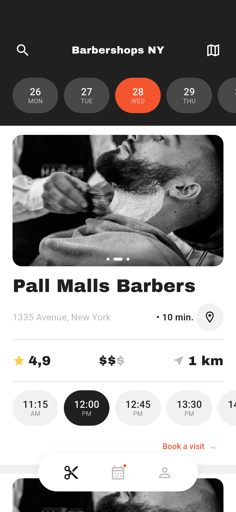
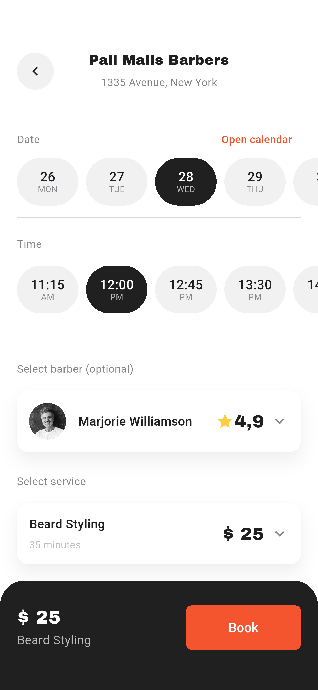
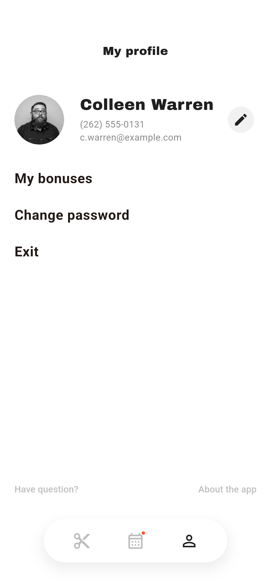
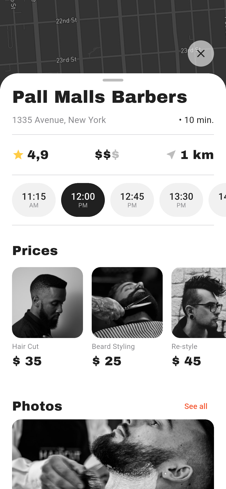
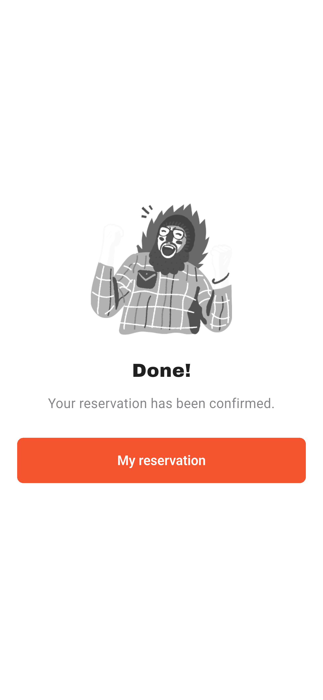
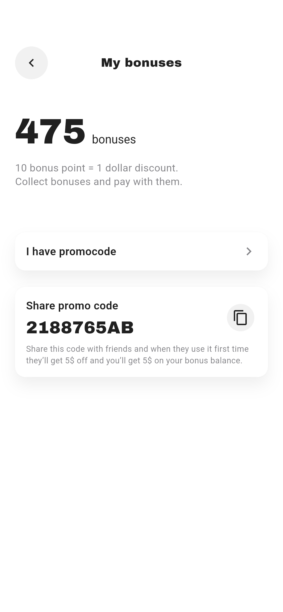
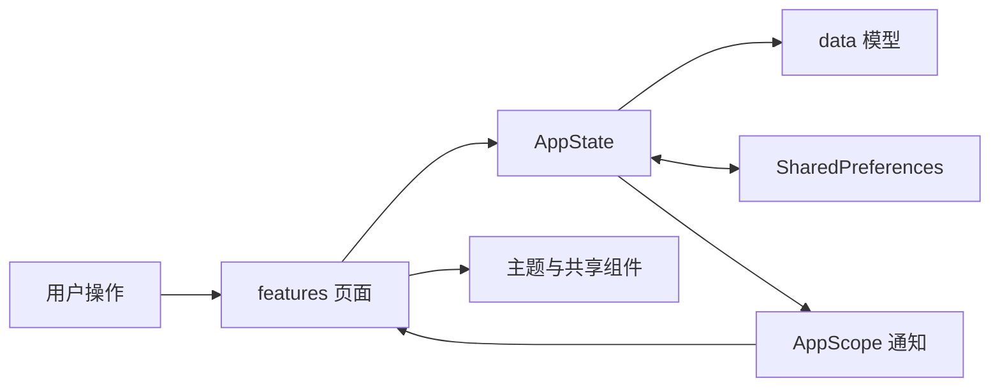

# BarberApp · Flutter 理发预约应用

按照 Pixso「Screens」页中的 25 张设计稿实现，包含发现门店、搜索、地图门店浮层、完整预约流程、预约记录和个人中心。保留原稿英文界面与黑白摄影风格，使用橙色主按钮和 Archivo Black 标题字体。

当前交付是可以在设备上运行的本地交互演示。预约、个人资料、登录标记与积分保存在当前设备；真实账号认证、地图定位、支付及服务端预约接口尚未接入。

演示安装包：[Android ARM64 APK](dist/BarberApp-android-arm64.apk)。

## 快速开始

环境：Flutter 3.41.6、Dart 3.11.4。项目包含 Android、iOS、Web 平台目录。

```bash
flutter pub get
flutter run -d emulator-5554
# 也可使用浏览器预览
flutter run -d chrome
```

登录表单预填 `c.warren@example.com` / `BarberApp123!`。演示允许任何格式正确的邮箱和至少 8 位密码；注册页额外校验两次密码一致。该规则仅用于浏览本地演示，不代表真实账号认证。退出后可重新进入。

优惠码演示使用 `218876`，可兑换一次 50 积分（5 美元），兑换后的余额为 525。

## 界面预览

以下图片来自 Android 模拟器中的实际 Flutter 页面。完整的 25 页运行截图见 [截图索引](docs/SCREENSHOTS.md)，对应 Pixso 原图保存在 `docs/reference/`。

| 门店首页 | 预约页面 | 个人中心 |
| --- | --- | --- |
|  |  |  |

| 门店详情 | 预约成功 | 积分中心 |
| --- | --- | --- |
|  |  |  |

## 功能与交互

- 欢迎、登录、注册：输入校验、清空输入、密码显示切换、页面切换和本地登录标记。
- 门店发现：横向日期和时间选项、门店列表、按名称过滤、门店详情入口。
- 地图：设计稿地图底图、三处可点选标记、缩放与复位；门店浮层可通过手柄点击或上下滑动切换高度。
- 预约：选择日期、日历、时段、服务、理发师，查看理发师详情，确认、成功提示和预约记录；相同日期、时段和理发师不允许重复预约，可取消预约。
- 评论：星级选择、文字评论和页面即时反馈；评论保存在当前会话内。
- 个人中心：修改姓名、电话、邮箱并保存；查看积分、复制分享码、校验并兑换演示优惠码。
- 密码页：当前密码必填、新密码长度和重复密码校验；账号安全变更需要后端，界面会明确提示这一点。

## 项目结构

```text
BarBer/
├── lib/
│   ├── main.dart                      # 初始化、AppScope 注入、25 个命名路由
│   ├── core/
│   │   ├── app_state.dart             # 共享状态、持久化和预约/积分规则
│   │   ├── theme.dart                 # 颜色、字体、按钮与浮层主题
│   │   └── widgets.dart               # 图片、表单、胶囊、卡片、导航等共享组件
│   ├── data/
│   │   └── models.dart                # Service / Barber / Shop / Reservation 与演示数据
│   └── features/
│       ├── auth/auth_screen.dart      # 欢迎、登录、注册
│       ├── discovery/discovery_screen.dart
│       │                              # 首页、搜索、地图、详情和评论
│       ├── booking/booking_screen.dart
│       │                              # 预约、选择器、理发师、确认和记录
│       └── account/account_screen.dart
│                                      # 资料、密码、积分和优惠码
├── assets/
│   ├── images/                        # Pixso 提取的本地照片、头像、地图与插画
│   └── fonts/                         # Archivo Black、Roboto 与各自 OFL 许可
├── test/                              # 状态持久化和页面布局/校验测试
├── integration_test/app_test.dart     # 模拟器端到端流程与 25 页截图
├── test_driver/integration_test.dart  # 集成测试驱动
├── tool/capture_android.sh            # 测试并导出 25 页截图
├── docs/
│   ├── ARCHITECTURE.md                 # 架构和数据流说明
│   ├── SCREENSHOTS.md                  # 25 页路由、截图与设计节点对应表
│   ├── TESTING.md                      # 验证结果、复现方法与交付边界
│   ├── screenshots/                   # App 实际运行截图
│   ├── reference/                     # Pixso 参考图
│   └── reports/                       # 最终验证日志
├── dist/BarberApp-android-arm64.apk    # Android ARM64 演示安装包
├── android/                           # Android 工程
├── ios/                               # iOS 工程
├── web/                               # Web 入口
└── pubspec.yaml
```

## 架构说明

采用按功能组织的轻量结构：页面负责展示与收集用户输入，`AppState` 处理跨页面选择、预约、资料和积分，`SharedPreferences` 保存需要跨启动恢复的数据。通过 Flutter 自带的 `ChangeNotifier` 与 `InheritedNotifier` 更新界面；导航使用内置 `Navigator`。生产依赖仅为 `shared_preferences`，没有额外引入状态管理、路由或网络框架。



详见 [架构说明](docs/ARCHITECTURE.md)。

## 验证与截图

```bash
flutter analyze
flutter test
./tool/capture_android.sh emulator-5554
flutter build apk --debug
```

页面测试覆盖 414 × 896 和 360 × 780 两种逻辑尺寸。模拟器流程覆盖登录、服务与理发师切换、预约确认、记录同步、资料保存和优惠码兑换。运行集成测试会清空此演示 App 的本地偏好数据，以保证结果可重复。

更详细的测试范围与平台限制见 [验证说明](docs/TESTING.md)。

## 精简处理

25 页按业务归并到 4 个功能文件，日历展开、门店浮层和预约选择器通过参数复用；成功与兑换完成共用一张结果页，资料和密码共用表单页。按钮、日期/时段、图片、卡片和底部导航复用共享组件。照片压缩为 JPEG，头像和插画保留 PNG；资源目录约 1.5 MB，运行时无需下载图片或字体。默认计数器页面及其测试已移除。
