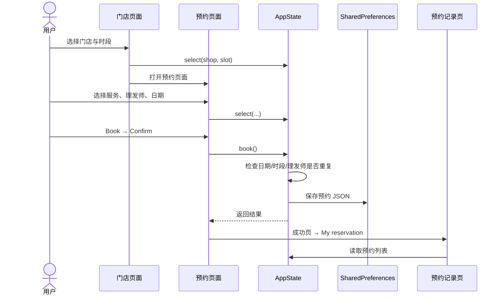

# 项目架构说明

## 设计输入与实现策略

设计来自 Pixso `Screens` 页（页面 ID `157:0`），包含 01—25 共 25 个手机画板，原稿尺寸 414 × 896。项目提取原稿照片、头像、地图及插画，并使用本地 Archivo Black 字体恢复标题风格；正文使用跨平台可打包的 Roboto。页面结构由 Flutter 组件构建，表单、列表、按钮和选择器均可交互。

Pixso 的 Flutter 代码导出接口在批量及单页请求中均超时，因此实现依据逐页截图、图层属性和导出的资源完成。未将自动生成的绝对定位代码带入项目。

## 分层和依赖方向

| 层 | 文件 | 职责 |
| --- | --- | --- |
| 应用入口 | `lib/main.dart` | 偏好存储初始化、竖屏方向、主题、共享状态注入与路由 |
| 业务界面 | `lib/features/` | 布局、表单校验、浮层、交互反馈、调用状态方法 |
| 共享展示 | `lib/core/widgets.dart`、`theme.dart` | 可复用控件、颜色、字体和样式 |
| 状态与存储 | `lib/core/app_state.dart` | 选择状态、创建和取消预约、保存资料、兑换积分 |
| 数据 | `lib/data/models.dart` | 领域对象、预约 JSON 序列化和演示数据 |

依赖从页面指向状态和数据，数据对象不依赖页面。当前存储逻辑规模较小，与状态放在同一文件；后续接入接口时可将读取、保存拆成 repository，并通过构造参数注入，不需要更改页面组件的视觉结构。

## 状态管理

`AppScope` 基于 `InheritedNotifier<AppState>`，持有一个 `ChangeNotifier`。页面使用 `AppScope.of(context)` 读取状态，调用 `select`、`book`、`saveProfile` 等方法完成变更。状态更新后统一 `notifyListeners()`，需要该状态的界面重新构建。

| 状态 | 生命周期 | 说明 |
| --- | --- | --- |
| 姓名、邮箱、电话 | 设备持久化 | 通过编辑资料表单保存 |
| 登录标记 | 设备持久化 | 决定启动页，不是服务端身份凭证 |
| 预约记录 | 设备持久化 | `Reservation` 列表编码为 JSON |
| 积分及优惠码使用标记 | 设备持久化 | 演示码只兑换一次，增加 50 积分 |
| 当前门店、服务、理发师、日期和时间 | 当前会话 | 所有预约相关页面共享 |
| 评论内容、星级 | 当前会话 | 在评论页面即时更新 |
| 表单内容、地图缩放和浮层高度 | 页面内 | 随对应页面销毁 |

不保存原始密码。演示登录只有输入格式校验，没有模拟真实身份校验或发送邮件。密码页的保存操作仅完成输入校验并提示后端尚未接入。

## 预约数据流

预约金额从选中 `Service.price` 读取，确认页、底部价格栏和记录卡片使用同一数据来源。日期从当前设备日期生成，初始选中两天后；附带一条三天后的示例记录，方便查看预约列表并保证初始预约不会与示例冲突。

## 页面归并

完整对应关系见 [25 页截图索引](SCREENSHOTS.md)。

- `AuthScreen(mode)`：欢迎、登录、注册。
- `MapScreen(level)`：地图及三个门店浮层层级；地图图片本身来自参考设计，不是实时地图。
- `BookingScreen(calendar, picker)`：普通预约、日历展开、服务和理发师选择弹层。
- `ReservationsScreen(previous)`：即将到来与历史示例记录。
- `EditAccountScreen(password)`：个人资料和密码表单。
- `SuccessScreen(bonus)`：预约完成和积分兑换完成。

## 视觉规范

| 项 | 值/方式 |
| --- | --- |
| 主文字/深色面板 | `#202020` |
| 主操作 | `#F4552F` |
| 次要文字 | `#858589` |
| 胶囊/浅色背景 | `#F1F1F1` |
| 星级 | `#FFCC46` |
| 标题 | Archivo Black，本地字体 |
| 正文 | Roboto，本地字体 |
| 照片 | 本地 JPEG/PNG，统一灰度呈现 |
| 大浮层 | 顶部 32 圆角 |
| 常规边距 | 22 逻辑像素 |

使用 `SafeArea`、`Expanded`、滚动列表和横向选项实现手机适配。日历使用 Flutter 原生月历，月份、星期和真实日期保持一致。系统状态栏、输入法、原生图标和日历细节遵循运行平台；这部分与 Pixso 的 iOS 静态示意存在差异。

## 后续接入位置

真实认证、短信或邮件、可用时段校验、支付和预约确认需要服务端。地图 SDK 还需要密钥、定位权限和真实地理数据；目前三个标记用于展示参考门店，不提供实际路线导航。优惠码和积分也仅在本机演示，实际业务必须由服务端校验。接入时优先将 `AppState` 中的存储调用拆成接口层；价格、预约容量与积分规则以服务端返回为准。
