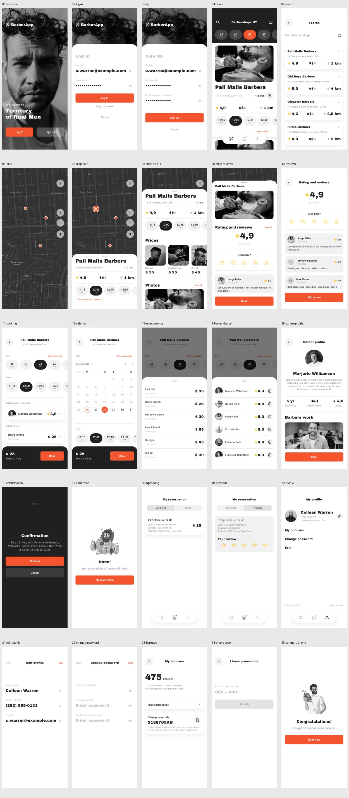
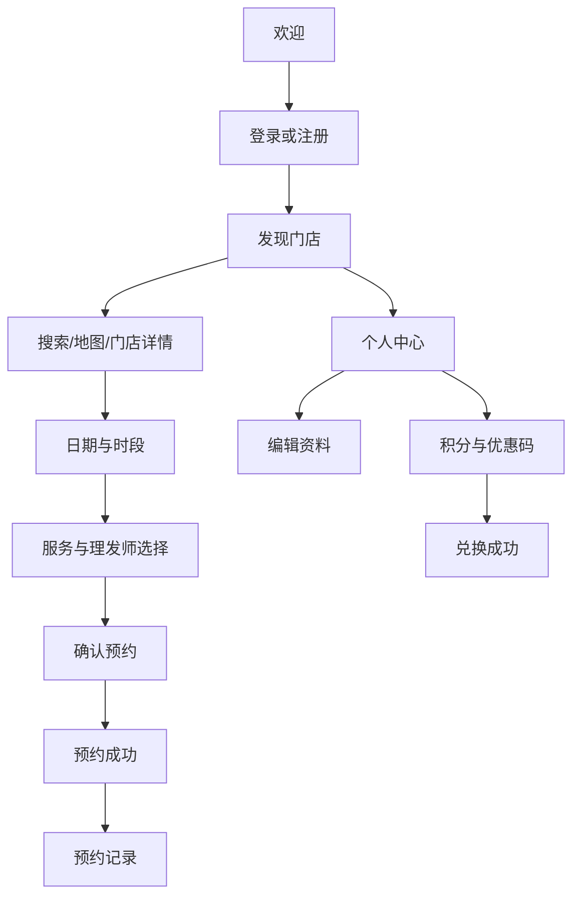

# 25 页截图索引

以下为 Android 模拟器中的实际 Flutter 界面截图。Pixso 原图单独保存，可逐页核对。截图中的日期使用运行设备时间。

| 序号 | 界面 | Flutter 路由 | App 截图 | Pixso 参考 | 节点 ID |
| --- | --- | --- | --- | --- | --- |
| 01 | 欢迎页 | `/welcome` | [运行图](screenshots/01-welcome.png) | [参考图](reference/01-welcome.png) | `319:0` |
| 02 | 登录 | `/login` | [运行图](screenshots/02-login.png) | [参考图](reference/02-login.png) | `319:22` |
| 03 | 注册 | `/signup` | [运行图](screenshots/03-sign-up.png) | [参考图](reference/03-sign-up.png) | `319:42` |
| 04 | 门店首页 | `/home` | [运行图](screenshots/04-home.png) | [参考图](reference/04-home.png) | `175:0` |
| 05 | 门店搜索 | `/search` | [运行图](screenshots/05-search.png) | [参考图](reference/05-search.png) | `273:2` |
| 06 | 地图 | `/map` | [运行图](screenshots/06-map.png) | [参考图](reference/06-map.png) | `204:385` |
| 07 | 地图门店概览 | `/map-small` | [运行图](screenshots/07-map-point.png) | [参考图](reference/07-map-point.png) | `207:102` |
| 08 | 门店详情与价格 | `/shop` | [运行图](screenshots/08-shop-details.png) | [参考图](reference/08-shop-details.png) | `207:252` |
| 09 | 门店评价浮层 | `/shop-reviews` | [运行图](screenshots/09-shop-reviews.png) | [参考图](reference/09-shop-reviews.png) | `207:406` |
| 10 | 评价列表 | `/reviews` | [运行图](screenshots/10-reviews.png) | [参考图](reference/10-reviews.png) | `240:45` |
| 11 | 预约页面 | `/booking` | [运行图](screenshots/11-booking.png) | [参考图](reference/11-booking.png) | `215:0` |
| 12 | 展开日历 | `/calendar` | [运行图](screenshots/12-calendar.png) | [参考图](reference/12-calendar.png) | `356:3241` |
| 13 | 选择服务 | `/services` | [运行图](screenshots/13-select-service.png) | [参考图](reference/13-select-service.png) | `359:367` |
| 14 | 选择理发师 | `/barbers` | [运行图](screenshots/14-select-barber.png) | [参考图](reference/14-select-barber.png) | `425:759` |
| 15 | 理发师资料 | `/barber` | [运行图](screenshots/15-barber-profile.png) | [参考图](reference/15-barber-profile.png) | `239:298` |
| 16 | 确认预约 | `/confirmation` | [运行图](screenshots/16-confirmation.png) | [参考图](reference/16-confirmation.png) | `247:0` |
| 17 | 预约成功 | `/confirmed` | [运行图](screenshots/17-confirmed.png) | [参考图](reference/17-confirmed.png) | `249:17` |
| 18 | 即将到来的预约 | `/reservations` | [运行图](screenshots/18-upcoming.png) | [参考图](reference/18-upcoming.png) | `259:259` |
| 19 | 历史预约 | `/previous` | [运行图](screenshots/19-previous.png) | [参考图](reference/19-previous.png) | `259:364` |
| 20 | 个人中心 | `/profile` | [运行图](screenshots/20-profile.png) | [参考图](reference/20-profile.png) | `250:7` |
| 21 | 编辑资料 | `/edit-profile` | [运行图](screenshots/21-edit-profile.png) | [参考图](reference/21-edit-profile.png) | `252:0` |
| 22 | 修改密码 | `/password` | [运行图](screenshots/22-change-password.png) | [参考图](reference/22-change-password.png) | `366:69` |
| 23 | 积分中心 | `/bonuses` | [运行图](screenshots/23-bonuses.png) | [参考图](reference/23-bonuses.png) | `254:39` |
| 24 | 输入优惠码 | `/promo` | [运行图](screenshots/24-promo-code.png) | [参考图](reference/24-promo-code.png) | `259:184` |
| 25 | 兑换成功 | `/congratulations` | [运行图](screenshots/25-congratulations.png) | [参考图](reference/25-congratulations.png) | `368:102` |

## 主要业务流程

`13`、`14` 是实际预约选择浮层；`06` 至 `09` 通过同一地图页的状态变化实现。所有主页面均有正常交互入口，命名路由也用于测试时直接定位对应设计状态。
